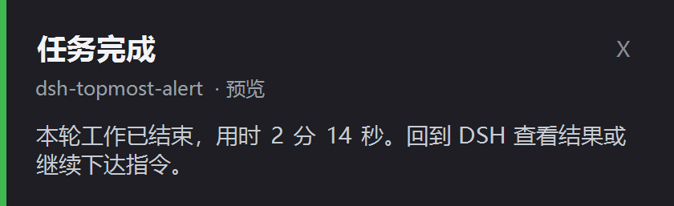

# dsh-topmost-alert

[](https://github.com/AA0111-A/dsh-topmost-alert)
[](LICENSE)

> 给 DeepSeek Harness 加一个**桌面最上层弹窗提醒**：智能体跑完、等你确认、等你回答或出错时，在屏幕右下角弹出一张无边框置顶卡片。



切到别的窗口干活时，不用一直盯着对话页，也能第一时间知道它是「跑完了」还是「在等你」。

- **置顶显示**：`TopMost` 窗口，压在其他窗口之上，切走也不怕错过。
- **按需出现**：完成 / 需要确认 / 需要回答 / 出错，四类时机可独立开关。
- **不打扰**：很短的对话不弹（默认 < 5 秒），子智能体（subagent）自己跑完不弹。
- **会自己消失**：「完成 / 出错」卡片自动消失；「需要你」的卡片会一直留着，直到你处理完才关闭。
- **无依赖、无联网**：宿主侧只有纯 ESM 代码，弹窗由系统自带的 PowerShell + WinForms 绘制。

---

## 环境要求

| 项目 | 要求 |
| --- | --- |
| 操作系统 | Windows 10 / 11（弹窗依赖 WinForms，其他平台不可用） |
| DSH | 建议较新的 desktop profile；插件以本地 bundle 形式挂载 |
| PowerShell | Windows PowerShell 5.1（系统自带）即可 |
| 显示缩放 | 100%–300% 均可（脚本自身声明 DPI 感知，按物理像素定位） |

## 安装

插件以**本地 bundle** 的形式安装，DSH 会把这个目录 link 进当前 profile，不需要构建，也没有 npm 依赖。

### 方式一：让 DSH 里的 Agent 安装（推荐）

```text
git clone https://github.com/AA0111-A/dsh-topmost-alert.git
```

然后在 DSH 会话里对你的 Agent 说：

> 把 `<仓库绝对路径>` 作为 bundle 安装

Agent 会调用 `plugin_manager install_bundle`，安装完成后插件即生效（`application: applied`）。若插件管理里没看到，重启一次 DSH。

### 方式二：手动挂载

1. 打开当前 profile 目录（Windows 下通常是 `%DSH_HOME%\profiles\desktop`），编辑 `package.json`：
   - `dependencies` 中增加：`"@local/dsh-topmost-alert": "link:<仓库绝对路径>"`
   - `dsh.profile.bundles` 中追加：`"@local/dsh-topmost-alert"`
2. 在 profile 目录执行一次 `pnpm install`。
3. 重启 DSH。

> 卸载：在插件管理里移除 `@local/dsh-topmost-alert`，或反向删除上面两处并重新 `pnpm install`。

## 配置

配置写在 Loader patch 的 `config` 里。你可以改仓库自带的 `cordis.patch.yml`，也可以更推荐地在 **profile 自己的 `cordis.patch.yml`** 里按 id 覆盖（升级插件不会丢配置）：

```yaml
- id: dsh-topmost-alert
  config:
    position: top-right
    minTurnSeconds: 15
    sound: false
```

全部配置项只有下面 8 个：

| 配置项 | 类型 | 默认值 | 说明 |
| --- | --- | --- | --- |
| `enabled` | boolean | `true` | 插件总开关。关掉后不再监听事件，也不再弹任何卡片。 |
| `notifyOnDone` | boolean | `true` | 本轮任务正常完成时是否弹卡。 |
| `notifyOnNeedsUser` | boolean | `true` | 等授权、等确认、等回答时是否弹卡。 |
| `notifyOnError` | boolean | `true` | 本轮执行出错时是否弹卡。 |
| `durationSeconds` | number | `20` | 「完成 / 出错」卡片的停留秒数，最小按 3 秒计。 |
| `minTurnSeconds` | number | `5` | 只对「完成」生效：本轮短于该秒数就不弹，避免快速回答也弹窗。 |
| `sound` | boolean | `true` | 弹卡时是否播放系统提示音。 |
| `position` | string | `bottom-right` | 卡片位置：`bottom-right`、`top-right`、`bottom-left`；其他值按 `bottom-right` 处理。 |

改完配置后重载/重启 DSH 生效（配置在插件挂载时读取）。

## 工作方式

```text
                        index.js（Host 半）                      popup/alert.ps1
  agent/status ─────────┐
  approval/request ─────┼─► 过滤 / 去重 / 节流 ─► 写 UTF-8 payload ─► 拉起 PowerShell ─► WinForms 卡片
  user-questions/request┤        （仅主会话）                        TopMost + DPI 感知
  agent/error ──────────┘                                           点击 / ESC / 超时关闭
                        └─ 审批结束时关闭对应卡片 ◄────────────── 进程退出
```

1. **Host 半**（`index.js`）订阅 DSH 的四个事件，按配置判断是否提醒，并做去重（3 秒内相同卡片只弹一次）、并发上限（最多 4 张）等节流。
2. 卡片内容写进 `%TEMP%\dsh-topmost-alert\*.json`（UTF-8），再把文件路径交给 `popup/alert.ps1`，避免中文在命令行/代码页里被破坏。
3. **弹窗半**（`popup/alert.ps1`）用 Windows PowerShell + WinForms 画一张无边框卡片：按类型取强调色（完成=绿、等待=琥珀、出错=红），`TopMost` 置顶，`SetProcessDPIAware` 保证 200% 缩放下也在屏幕内，点击卡片、点 ×、按 ESC 或到时自动关闭。
4. 「需要你确认 / 回答」的卡片与审批生命周期绑定：你在 DSH 里作出选择后，对应窗口立即关闭。

### 一些细节

- 只提醒你**直接交互的会话**；子智能体自己完成或报错不提醒（避免团队协作时刷屏）。
- DSH 启动后的前 15 秒忽略「完成」提醒，避免恢复旧会话时误弹。
- 只支持**主显示器**右下角/右上角；多屏目前不跟随光标所在屏幕。
- 卡片是独立进程，DSH 关闭后不会再有任何提醒。

## 故障排查

**卡片没出现**

1. 确认是 Windows，且 `powershell.exe` 存在（`C:\Windows\System32\WindowsPowerShell\v1.0\`）。
2. 打开调试日志：给 DSH 进程设置环境变量 `DSH_ALERT_DEBUG=1`，重启 DSH，复现后查看 `%TEMP%\dsh-alert-debug.log`——脚本会记录 payload、尺寸、位置与退出原因，异常也会写在这里。
3. 检查插件是否被禁用：插件管理里「顶层提醒」应为启用状态。

**卡片位置不对 / 被缩放**

脚本已声明 DPI 感知并按物理像素定位；若仍异常，多为系统缩放策略或虚拟桌面限制，可在日志里核对 `card size=... at=...` 与屏幕分辨率是否匹配。

**提示音不响**

`SystemSounds` 依赖系统声音方案；静音或关闭系统提示音时无声属预期。

## 目录结构

```text
dsh-topmost-alert/
├─ package.json          # 包清单：bundle patch、locale/icon 导出、仓库元数据
├─ cordis.patch.yml      # Loader 挂载入口（insert: dsh-topmost-alert）
├─ index.js              # 插件入口：订阅事件、判定时机、文案与节流
├─ lib/alert.js          # 弹窗进程管理：payload 落盘、拉起 PowerShell、并发与关闭
├─ popup/alert.ps1       # 置顶卡片本体（PowerShell 5.1 / 7 兼容，纯 ASCII 源码）
├─ locale/zh.json        # 中文展示元数据
├─ locale/en.json        # 英文展示元数据
├─ icon.svg              # 64×64 原创图标
├─ docs/preview.png      # README 预览图
├─ LICENSE               # MIT
└─ README.md
```

## 开发

没有构建步骤：`index.js` 与 `lib/alert.js` 是纯 ESM，直接改文件即可；修改后重启 DSH 让新模块生效。`popup/alert.ps1` 可以独立调试：

```powershell
powershell -NoProfile -ExecutionPolicy Bypass -File popup\alert.ps1 -PayloadFile payload.json
```

`DSH_ALERT_DEBUG=1` 时脚本会把诊断信息追加到 `%TEMP%\dsh-alert-debug.log`。

## 隐私

- 不联网、不上报、无遥测、无第三方依赖。
- 卡片内容来自当前会话（会话标题、工具名、问题文本），只会写进本机 `%TEMP%` 并在卡片关闭后删除。
- 仓库内不包含任何个人路径、密钥或令牌。

## English

**dsh-topmost-alert** is a DeepSeek Harness plugin that shows an always-on-top Windows alert card when an agent finishes a turn, waits for your approval, asks a question, or errors out. Requirements: Windows 10/11 and DSH. Install the directory as a local bundle (`plugin_manager install_bundle`); configure the eight options above through the Loader `config`; uninstall by removing the bundle. No build step, no dependencies, no network access. Licensed under [MIT](LICENSE).

## License

[MIT](LICENSE) © 2026 AA0111-A
